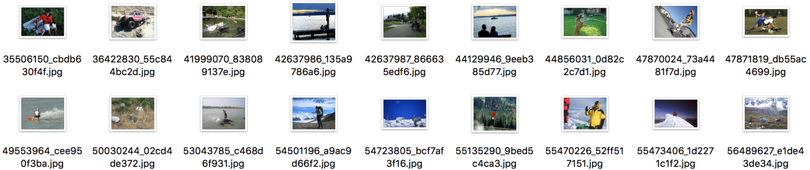
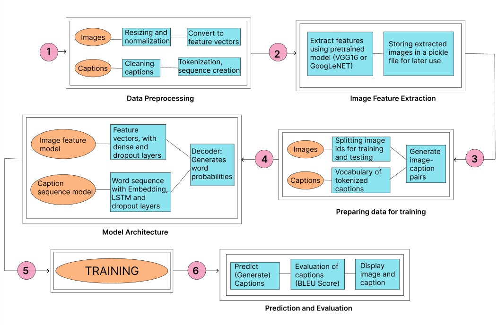
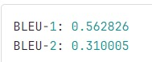

# Image Captioning
This repository contains the codes and resources for the Image Captioning Project.

## Table of Contents
* [Introduction](#introduction)
* [Features](#features)
* [Dataset](#dataset)
* [Model](#model)
* [Results](#results)
* [Contribution](#contribution)
* [Acknowledgements](#acknowledgements)

## Introduction
This project aims to generate descriptive captions for images using deep learning techniques. The primary goal is to understand and implement an image captioning model that can generate coherent and contextually accurate descriptions for given images.

## Features

## Dataset
<b>Flickr8k: </b> The Flickr8k dataset contains 8,000 images, each with five different human-generated captions. It is commonly used for training and evaluating image captioning models. The dataset provides a diverse set of images from various categories and contexts, making it ideal for tasks involving natural language understanding and generation.

<b>Flickr30k: </b> The Flickr30k dataset includes 30,000 images, with each image annotated with five distinct captions. It extends the Flickr8k dataset with a larger variety of images and more detailed descriptions, offering a more comprehensive resource for training image captioning models. The captions are diverse and cover a wide range of objects, actions, and scenes.

## Model
<b>Block Diagram of the model: </b>

## Results
<b> For the GoogLeNET model used (30k dataset): </b>

